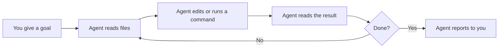
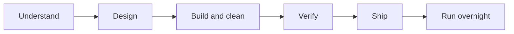

# Start here: pstack for people new to coding agents

This page is for you if you have never used Cursor, or any coding agent. You will learn the words first, then use them. After about 20 minutes you will have installed pstack, asked it a question about code, made one small verified change, and read the proof.

You do not need to read the other guide pages first. This page links to them when you are ready for more.

## What you need

- Cursor, installed and signed in.
- A small project you can afford to break. A copy of a real project works. So does a tutorial project.
- Git in that project. You will learn the few git words you need in Part 1.

## How this page works

There are four parts. Each part builds on the one before it.

1. **The language of coding agents.** What an agent is, and the ten words that explain how it works.
2. **The language of plugins.** What a skill, a rule, an MCP server, and a plugin are.
3. **The language of pstack.** What pstack adds, and its six words.
4. **Your first task.** Seven steps that use all the words.

A glossary and a short self-check are at the end.

---

## Part 1. The language of coding agents

### A chat bot talks. A coding agent works.

A chat bot answers questions with text. A **coding agent** also acts. It reads your files, edits them, and runs commands on your computer. Then it reads the results and decides what to do next.

That loop is the core idea. Everything else on this page is a way to make the loop safer or faster.



Cursor is the program that hosts the agent. You can use it in the editor, in the Agents Window, or in the command line (CLI).

### Ten words you need

| Word | Meaning | What you will see |
|---|---|---|
| **Model** | The AI that does the thinking. Different models have different strengths. Examples are Claude Opus and Grok. | A model name in the chat. pstack can use more than one model in one task. |
| **Prompt** | The message you type to the agent. | The text box. |
| **Chat** | One conversation with an agent. Some tools call it a session. This page says "chat". | A new chat starts empty. |
| **Context** | Everything the agent holds in view right now: your messages, the files it read, the command output. | The agent can forget old details in a long chat. |
| **Context window** | The size limit on context. When it fills, quality drops. | pstack sends bulk reading to subagents to protect it. |
| **Tool** | An action the agent can take. Read a file, edit a file, run a command, search. | Lines in the chat that show what the agent did. |
| **Subagent** | A helper agent that the main agent starts. It has its own context. It does one job and sends back a summary. | Several agents at work in parallel. |
| **Reasoning effort** | How long a model thinks before it answers. Higher effort costs more tokens. | Labels such as `medium`, `high`, `xhigh`, `max`. |
| **Token** | The unit of text a model reads and writes. You pay by the token. | Cost. More subagents use more tokens. |
| **Slash command** | A command that starts with `/`. You type `/` and pick from a menu. | `/poteto-mode`, `/how`, `/setup-pstack`. |

### Six git words you need

pstack works with git. You need only these words.

| Word | Meaning |
|---|---|
| **Repo** | A project folder that git tracks. |
| **Commit** | A saved snapshot of your changes, with a message. |
| **Branch** | A separate line of commits. You can change a branch without touching your main code. |
| **Diff** | The lines that changed between two versions. |
| **Worktree** | A second copy of the project on disk, on its own branch. Two agents in two worktrees cannot overwrite each other. |
| **PR** | Pull request. A request to merge one branch into another, on GitHub. Other people review it, and CI runs on it. |

**CI** is a set of automatic checks that run on every PR. A PR is "green" when the checks pass.

### Why agents fail, and what the fix is

An agent fails in two common ways.

1. It misreads what you want.
2. It does not have the context to do the work correctly.

An agent also has one more habit. It says "done" when the code compiles. A compiled program is not a working program.

pstack is built around these three problems. Keep them in mind in Part 3.

---

## Part 2. The language of plugins

Your agent starts with a fixed set of abilities. You add more with five kinds of parts.

| Part | What it is | Example |
|---|---|---|
| **Skill** | A folder with a `SKILL.md` file. It holds instructions for one kind of job. The agent reads it when you type its name, or when another skill calls it. | `/how` explains code. |
| **Rule** | Instructions that Cursor adds to every chat. A rule is always on. | `~/.cursor/rules/pstack-models.mdc` holds your model choices. |
| **Subagent definition** | A file that describes a helper agent and how it should behave. | pstack ships `poteto-agent` and `comment-sicko`. |
| **MCP server** | A connection from the agent to an outside tool. MCP means Model Context Protocol. It can link an issue tracker, team chat, or an error tracker. | `/why` uses your MCP servers to find the history of a decision. |
| **Plugin** | A bundle of the other four parts. You install it with one command. | pstack. |

A skill is only text. It has no program inside it. It works because the agent reads it and follows it. This is why you can open any skill and read exactly what it will tell the agent to do.

### What pstack contains

The file `.cursor-plugin/plugin.json` in the pstack folder lists what the plugin provides. It points to two folders.

- `skills/` holds the skills. These are the slash commands and the principles.
- `agents/` holds the two subagent definitions.

pstack adds one rule to your computer, and only after you run `/setup-pstack`. Installing pstack does not change how your agent behaves. Nothing in pstack runs until you type one of its skills. The only exception is `/setup-pstack`, which Cursor can load from your own words.

### Two ways to start a skill

When you pick a skill from the `/` menu, you have two choices.

- Press **Enter**. The skill attaches to this one message. It fades as the chat moves on.
- Press **Option+Enter** (Mac) or **Alt+Enter** (Windows). The skill becomes a **Custom Mode**. It stays in context on every turn until you exit the mode.

Custom Modes are available in the Agents Window and the CLI. In the editor chat, start each new task with the skill name instead.

---

## Part 3. The language of pstack

### The idea

pstack is a set of skills from [poteto](https://x.com/poteto), who ships code at Cursor. The goal is not more code. The goal is less code of higher quality.

The rule behind it is "if you want to go fast, go deep first." One agent that checks its own work is worth more than five agents that each hand you unchecked work. When you trust one agent, you can run several at once. pstack calls this fearless parallelism.

### Six pstack words

**1. `/poteto-mode`: the front door.** You type it at the start of a task. It reads your request, picks a playbook, and runs the other skills when each step needs them. For almost every task, this is the only pstack command you need.

**2. Playbook.** A written list of steps for one kind of job. There are 23. Examples are Bug fix, Feature, Investigation, and Refactoring. A playbook is not a slash command. `/poteto-mode` picks one from your words.

When it picks a playbook, it copies the steps into the todo list. If it skips a step, the step stays in the list with `skip: <reason>`. You can always see what it chose not to do.

**3. Principle.** A short skill that holds one rule. There are 24. Examples are "Prove It Works", "Fix Root Causes", and "Subtract Before You Add". The agent names each principle it applied and the decision it changed. You can also type a principle name to steer the agent. "Apply prove it works. Show me the real output" is a complete instruction.

**4. Skill, used directly.** You can type a single skill when you want only that job. The most useful ones for a beginner are below.

| Skill | Use it to |
|---|---|
| [`/how`](../../skills/how/SKILL.md) | Learn how part of the code works now. |
| [`/why`](../../skills/why/SKILL.md) | Learn why the code was built that way. |
| [`/teach`](../../skills/teach/SKILL.md) | Get a plain explanation that builds up step by step. |
| [`/bro`](../../skills/bro/SKILL.md) | Hear the last reply again in plain words, with no jargon. |
| [`/in-your-own-words`](../../skills/in-your-own-words/SKILL.md) | Make the agent play back your goal before it starts. |
| [`/interrogate`](../../skills/interrogate/SKILL.md) | Have different models try to break a diff. |
| [`/poteto-help`](../../skills/poteto-help/SKILL.md) | Ask which skill fits. It gives you a prompt to send. |

**5. Role, panel, and budget.** pstack gives each job a **role**, such as "code", "judgment and prose", or "review". Each role has a model. A **panel** is a role that runs several models at once, one subagent for each model. The **budget** sets the reasoning effort for all roles. `/setup-pstack` lets you change all three. Out of the box, code work goes to Grok, and the hardest changes and the judgment work go to Opus 5.5.

**6. Verification skill.** A skill in your project, named `verify-<app>`. It teaches an agent how to run your app and check a change the way a user would. An agent with this skill checks its own work and keeps going until the check passes. An agent without it gives you the checking to do by hand.

### Where pstack fits in the life of a change

Most work follows the same path. Each stage has a page in the full guide.



| Stage | The question it answers | Main tools | Guide page |
|---|---|---|---|
| Understand | How does this work? Why is it this way? | `/how`, `/why`, `/teach`, `/recall` | [Understand the code](./03-understand.md) |
| Design | What shape should the change have? | `/architect`, `/arena`, prototypes | [Design the change](./04-design.md) |
| Build and clean | How do I make the change, and keep the diff small? | Build playbooks, `/tdd`, `/unslop`, `/no-comments` | [Build and clean](./05-build-and-clean.md) |
| Verify | Does it really work? | The verification skill, `/benchmark-checklist` | [Verify and ship](./06-verify-and-ship.md) |
| Ship | How do I merge it safely? | Opening a PR, Babysit, and Shipping playbooks | [Verify and ship](./06-verify-and-ship.md) |
| Run overnight | Can it work while I am away? | `/loop`, `/show-me-your-work` | [Run work while you sleep](./07-overnight.md) |

You do not choose a stage by hand. `/poteto-mode` reads your goal and enters the right stage.

---

## Part 4. Your first task

Open your practice project in Cursor. Use a new git branch, or a copy of the project.

### Step 1. Install pstack

In a Cursor chat, type:

```text
/add-plugin pstack
```

Cursor confirms that the plugin is installed. You can also install it from Customize in the sidebar.

### Step 2. Set your models and budget

Type:

```text
/setup-pstack
```

`/setup-pstack` finds the models you can use. Then it asks you for a budget. Pick one.

| Budget | Reasoning effort | Cost |
|---|---|---|
| `unlimited` | `max` where the model allows it | Highest |
| `large` | `xhigh` (this is the default) | High |
| `medium` | `high` | Lower |
| `small` | `medium` | Lowest |

For your first run, pick `large` or `medium`. Accept the role list as shown. You can run `/setup-pstack` again at any time.

If you use Cursor's Auto model, set the roles to `auto` or `inherit-parent`. Both values mean that the role runs on the model of your chat.

At the end, `/setup-pstack` may offer to create a verification skill for your project. Say yes if you can. You will do this properly in Step 6.

**Start a new chat now.** The rule that setup wrote applies to new chats only.

### Step 3. Ask a question and change nothing

Before you edit anything, learn how the code works. Pick a feature of your project and ask about it:

```text
/how does <feature> work? give me the main files and the order things run in.
```

Replace `<feature>` with a real feature, such as "login" or "the search box".

What to expect. `/how` reads the code and answers like a senior engineer who is onboarding you. It gives the flow at runtime, the key types, and the parts that are not obvious. For a large area, it starts two to four read-only helpers first.

If a word in the answer is new to you, type this:

```text
/bro
```

`/bro` says the last reply again in plain words.

A question is read-only. If you want the same behavior with `/poteto-mode`, add "don't change any code yet" to your prompt. That phrase routes the task to the Investigation playbook.

### Step 4. Make one small change, with a check

Now start a real task. A good prompt has up to five parts.

| Part | What to write |
|---|---|
| The goal | What is wrong, or what you want. |
| The done check | A test that can pass or fail. "Make it better" is not a check. |
| The proof | What you want to see. The real command output, a screenshot, or a before-and-after number. |
| What you know | A symptom, a log line, or a link. |
| Real constraints | "Repro first." "Don't change the text output." "Let me review before you proceed." |

Here is a complete prompt. Change the words to fit your project:

```text
/poteto-mode change the heading on the home page to "Welcome back". done means the new heading shows in the running app and no other text changes. show me a screenshot.
```

Do not list skills or steps in your prompt. The playbook already holds the right steps in the right order. A hand-written list usually drops some of them.

Do not state a theory of the cause at first, when you are fixing a bug. The agent will search only where you point. Let it describe the problem in its own words, then add your idea.

### Step 5. Watch the todo list

When you send the prompt, `/poteto-mode` does these things in order.

1. It reads the principles index.
2. It matches your task to a playbook. For the prompt above, this is the Feature playbook.
3. It opens a todo list. The first items are the playbook steps, copied word for word.
4. It runs the steps and calls other skills as each step needs them.
5. It writes a reply.

Look at the todo list while the agent works. Check for two things.

- A step with `skip: <reason>`. Read the reason. A skip is allowed, but it must make sense to you.
- A step that shows evidence, such as a command output or a screenshot.

### Step 6. Read the reply for proof

A good reply shows proof, not only a claim. Use this checklist.

- It names the **real command or flow** it ran, and its output. "It compiles" is not proof.
- Each claim is labelled as **measured**, **inferred**, or **guess**.
- It says **inconclusive** when a check could not run. A confident reply with no evidence is a warning sign.
- It names each principle it applied, and the decision that principle changed.
- It says who the change is for, and what the next engineer who owns the code will inherit.

If the proof is missing, ask for it in plain words:

```text
apply prove it works. run the real flow and show me the output.
```

If your project has no way to run the app by script, create one. Type `/create-verification-skill`. It reads your repo, works out how to launch and drive the app, and writes `.cursor/skills/verify-<app>/`. It proves the new skill works once before it gives it to you. If that proof fails, do not use the output. After this, you can write "use `/verify-<app>` and show me a video" in any prompt.

### Step 7. Review, then continue

For a change you do not fully trust, ask for a review by different models:

```text
/interrogate review my changes. only report real bugs or regressions.
```

`/interrogate` sends the diff to reviewers on different model families. A problem that two models raise independently is a strong signal. It sorts the results into Act on, Consider, Noted, and Dismissed, with a reason for each dismissal. It applies nothing on its own.

To turn the change into a pull request, type:

```text
/poteto-mode open the pr. small ordered commits, evidence in the description.
```

This needs a GitHub remote. The agent works from a worktree, cleans the diff, and gives you the PR link.

For your next task, do one of two things.

- Say "new task" at the start of the prompt. This tells `/poteto-mode` to choose a fresh playbook.
- Press Option+Enter or Alt+Enter on `/poteto-mode` in the `/` menu to make it a Custom Mode. Then short follow-ups such as "continue" or "keep going until done" are enough.

You have now used every part of pstack's core loop.

---

## Habits that make pstack work

1. **State the goal and the check. Do not state the steps.** The playbook owns the steps.
2. **Ask before you edit.** Use `/how` or "don't change any code yet" on code you do not know.
3. **Ask for proof you can inspect.** A video, a screenshot, a command output, or a before-and-after number.
4. **Say "new task" when you change subject.** A mode in the middle of one playbook will otherwise treat your question as the next step.
5. **Use `/poteto-mode` for work that needs rigor.** A small, obvious edit does not need it. Rigor spends tokens.

## When something goes wrong

| What you see | Fix |
|---|---|
| The mode stopped applying after a few turns. | You started it with Enter. Start it as a Custom Mode, or start each task with `/poteto-mode`. |
| A question was treated as the next step of the old task. | Say "new task". |
| A new model choice has no effect. | Start a new chat. The setup rule applies to new chats only. |
| Runs cost more than you expected. | Run `/setup-pstack` again. Choose a smaller budget, or set roles to `auto`. |
| A reply claims success from a passing build. | Ask for the real command, flow, or stored value. |
| You do not understand a reply. | Type `/bro`, or `/teach` for a longer explanation. |
| You do not know which skill to use. | Type `/poteto-help` and ask. |

## Cost

pstack spends extra tokens on subagents and review panels. This is the price of the extra checking. To spend less, pick a smaller budget, set roles to `auto`, or shorten a panel list. Each entry in a panel runs one subagent.

---

## Glossary

| Term | Meaning |
|---|---|
| **Agent** | An AI that reads files, edits them, and runs commands, in a loop, to reach a goal. |
| **Branch** | A separate line of commits in git. |
| **Budget** | A pstack setting for the reasoning effort of all roles. |
| **CI** | Automatic checks that run on a pull request. |
| **Commit** | A saved snapshot of changes. |
| **Context** | What the agent holds in view during a chat. |
| **Custom Mode** | A skill kept in context on every turn. Start it with Option+Enter (Mac) or Alt+Enter (Windows). |
| **Diff** | The lines that changed. |
| **MCP server** | A connection from the agent to an outside tool. |
| **Model** | The AI that does the thinking. |
| **Panel** | A role that runs several models at once, one subagent for each. |
| **Playbook** | A written step list for one kind of job. `/poteto-mode` picks one. |
| **Plugin** | A bundle of skills, rules, subagents, and MCP servers. |
| **Principle** | A short skill that holds one rule. |
| **Prompt** | The message you type to the agent. |
| **PR** | Pull request. A request to merge a branch. |
| **Reasoning effort** | How long a model thinks before it answers. |
| **Role** | A job in pstack that has its own model, such as code or judgment. |
| **Rule** | Instructions that Cursor adds to every chat. |
| **Skill** | A folder with a `SKILL.md` file of instructions for one job. |
| **Slash command** | A command that starts with `/`. |
| **Subagent** | A helper agent with its own context. |
| **Token** | The unit of text a model reads and writes. |
| **Tool** | An action an agent can take, such as read, edit, or run. |
| **Verification skill** | A project skill, `verify-<app>`, that lets an agent run your app and check a change. |
| **Worktree** | A second copy of the project on disk, on its own branch. |

## Check yourself

Answer these without looking. The answers are under the list.

1. What is the difference between a chat bot and a coding agent?
2. What is the difference between a skill and a plugin?
3. Is a playbook a slash command? Who picks it?
4. You see `skip: <reason>` in the todo list. What does it mean?
5. A reply says "done, it compiles". What do you ask for?
6. Why does the setup rule not affect the chat where you ran `/setup-pstack`?

<details>
<summary>Answers</summary>

1. A chat bot answers with text. A coding agent also reads files, edits them, and runs commands, then reads the results and continues.
2. A skill is one folder of instructions for one job. A plugin is a bundle that can hold skills, rules, subagent definitions, and MCP servers.
3. No. A playbook is a step list inside `/poteto-mode`. `/poteto-mode` picks it from the words in your prompt.
4. `/poteto-mode` chose not to run that step, and it wrote the reason. You can read the reason and disagree.
5. Ask for proof from the real artifact. That means the real command output, the running flow, or the stored value. Ask for "prove it works".
6. The rule applies to new chats only. Start a new chat after setup.

</details>

## Where to go next

Read the full guide in order, or jump to the stage you need.

1. [Set up pstack](./01-setup.md). More detail on models and cost.
2. [Route work through `/poteto-mode`](./02-poteto-mode.md). How to word prompts.
3. [Understand the code](./03-understand.md).
4. [Design the change](./04-design.md).
5. [Build and clean the change](./05-build-and-clean.md).
6. [Verify and ship](./06-verify-and-ship.md).
7. [Run work while you sleep](./07-overnight.md).
8. [Steer with principle names](./08-principles.md).
9. [Make it yours](./09-make-it-yours.md).
10. [Recipes and pitfalls](./10-recipes-and-pitfalls.md).

If you are stuck, or you do not know which skill fits, type [`/poteto-help`](../../skills/poteto-help/SKILL.md) with your question.
