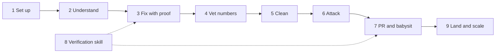

# Worked example: one bug, the whole pstack path

This page follows one bug from first report to merged PR. It shows which pstack part fires at each stage, and what to type.

The example is built from the guide pages and the playbook descriptions. It was not run, so each "What happens" line says what the docs describe, not captured output.

## The scenario

Your app exports orders to CSV. Since yesterday's deploy, the last row is missing. You do not know the code. Steps 2 to 7 and step 9 each fit in a chat. Step 8 is a one-time project setup.



## Step 1. Set up once

```text
/add-plugin pstack
/setup-pstack
```

Pick the `large` budget and accept the roles. Start a new chat after setup, because the rule applies to new chats only. See [Set up pstack](./01-setup.md).

## Step 2. Understand before you touch anything

```text
/how does the csv export work? give me the main files and the order things run in.
```

**What happens.** [`/how`](../../skills/how/SKILL.md) reads the code and explains the runtime flow, the key types, and the non-obvious parts. If a word is new to you, type [`/bro`](../../skills/bro/SKILL.md).

Then ask about history:

```text
/why was the export changed in yesterday's deploy?
```

**What happens.** [`/why`](../../skills/why/SKILL.md) starts from source control. It then searches any MCP servers you have connected, such as an issue tracker or team chat, and reports what it found. If it finds nothing, it says so. See [Understand the code](./03-understand.md).

## Step 3. Fix the bug with proof

```text
/poteto-mode the csv export drops its last row since yesterday's deploy. failing job id is 4812. repro first, then fix. done means the 60k-row fixture exports every row. show me the row counts before and after.
```

This prompt has all five parts. The goal is the missing row. The done check is the 60k-row fixture. The proof is the row counts. What you know is the job id. The constraint is "repro first".

**What happens.**

1. `/poteto-mode` matches the [Bug fix playbook](../../skills/poteto-mode/playbooks/bug-fix.md).
2. It copies the playbook steps into the todo list. A skipped step stays visible as `skip: <reason>`.
3. It reproduces the defect first, then traces to the root cause and fixes it there.
4. The reply shows the row counts before and after. Each claim is labelled measured, inferred, or guess. It names each principle it applied, such as [Fix Root Causes](../../skills/principle-fix-root-causes/SKILL.md) and [Prove It Works](../../skills/principle-prove-it-works/SKILL.md), and the decision each one changed.

If the reply claims success without evidence, send:

```text
apply prove it works. run the real export and show me the row counts.
```

## Step 4. Vet a number, only if you claim one

Skip this step for a plain bug fix. If your fix claims a speedup, vet it first:

```text
/benchmark-checklist vet the export speedup before it goes in the pr
```

It asks seven questions and gives a verdict of faster, slower, no measurable difference, or inconclusive. See [Verify and ship](./06-verify-and-ship.md#vet-a-measured-number-with-benchmark-checklist).

## Step 5. Clean the diff

```text
/no-comments the diff
```

A separate reviewer, [Comment Sicko](../../agents/comment-sicko.md), removes comments that the author would defend. Then ask for a cleanup of extra code. `/deslop` ships in the `cursor-team-kit` plugin, not in pstack. Without it, ask in plain words to remove narrating comments, unsupported guards, dead compatibility paths, and unrelated edits. See [Build and clean](./05-build-and-clean.md).

## Step 6. Attack the change

```text
/interrogate review my changes. only report real bugs or regressions.
```

Reviewers on different model families read the diff. The lead sorts findings into Act on, Consider, Noted, and Dismissed, with a reason for each dismissal. It applies nothing by itself. You decide. See [Design the change](./04-design.md#break-it-with-interrogate).

## Step 7. Open the PR and drive it to merge-ready

```text
/poteto-mode open the pr. small ordered commits, evidence in the description.
```

Then:

```text
/poteto-mode babysit this pr. get it green.
```

Babysit handles blockers in this order: conflicts, review threads, CI. It batches fixes into one push. It stops at merge-ready and never merges by itself.

## Step 8. Make the proof repeatable

Do this once per project. If agents cannot drive your app by script, type:

```text
/create-verification-skill
```

It writes `.cursor/skills/verify-<app>/`, with launch, doctor, drive, evidence, and cleanup sections plus a Feature Map. Commit it. From then on, a prompt can say "use `/verify-<app>` and show me a video". Run `/maintain-verification-skill` at least once a day to keep the map true. The [Article tab](tab:article) explains why the author treats this as the first skill to build.

## Step 9. Land it, then scale

```text
/poteto-mode land the stack.
```

The Shipping playbook verifies each PR with a fresh agent before it merges anything. It lands only the unbroken run of verified PRs from the bottom up.

To work while you sleep, state a finish condition and ask for a log:

```text
/poteto-mode im going to bed. keep going until the 60k-row fixture exports every row on main. log your decisions.
```

In the morning, type `/show-me-your-work catch me up on what you did last night`. Read the Attention section first. See [Run work while you sleep](./07-overnight.md).

## What this example shows

| Stage | pstack part used |
|---|---|
| Understand | `/how`, `/why`, `/bro` |
| Build | `/poteto-mode`, Bug fix playbook, principles |
| Clean | `/no-comments` |
| Verify | proof in the reply, `/create-verification-skill` |
| Review | `/interrogate` |
| Ship | Opening a PR, Babysit, and Shipping playbooks |
| Overnight | `/show-me-your-work` |

The example does not use the Design stage (`/architect`, `/arena`). A bug fix with a known cause needs no design work, and the guide says most changes need none of it. The [Video tab](tab:video) maps all six stages.
